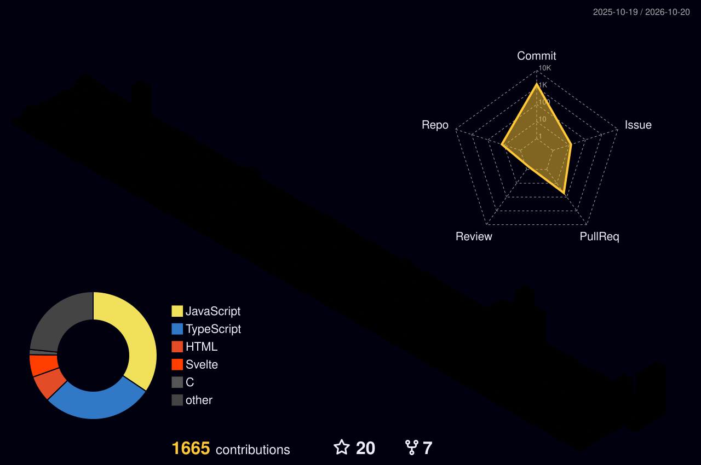

  
  
  
  
  

<h2> Hey! Nice to see you.</h2>

I'm **Shivam Meena**, a senior software engineer in Hyderabad, India. I build and ship complete products with Svelte, SvelteKit and TypeScript, mostly on Cloudflare's developer platform, and I maintain open source libraries that other teams run in production.

- :package: Maintainer of [sveltekit-og](https://github.com/etherCorps/sveltekit-og), featured on the official Svelte blog.
- :bell: Building [Doota](https://github.com/etherCorps/doota), open source self-hosted email on Cloudflare.
- :briefcase: Independent software consultant, building full-stack products for international clients.
- :rocket: Previously at Kleio AI, where I owned the embeddable widget that served 200k+ active users.
- :pencil: I write about Svelte on dev.to as [@theether0](https://dev.to/theether0).

## :hammer_and_wrench: Open source

<table>
  <tr>
    <td width="50%" valign="top">
      <h3><a href="https://github.com/etherCorps/sveltekit-og">sveltekit-og</a></h3>
      
Open Graph images from HTML/CSS or Svelte components in SvelteKit, with no headless browser. Runs on Node, Deno, Vercel, Netlify and Cloudflare, with Satori and Takumi renderers.

      
      
      
    </td>
    <td width="50%" valign="top">
      <h3><a href="https://github.com/etherCorps/doota">Doota</a></h3>
      
Self-hosted email on your own Cloudflare account: threaded conversations, encryption at rest, scheduled and undo send, hide-my-email aliases and passkey sign-in. Featured in the official Svelte blog community showcase, August 2026.

      
      
      
    </td>
  </tr>
  <tr>
    <td width="50%" valign="top">
      <h3><a href="https://www.npmjs.com/package/@ethercorps/un-jinja">un-jinja</a></h3>
      
Zero-dependency, Jinja2-compatible template engine for JavaScript.

      
      
    </td>
    <td width="50%" valign="top">
      <h3><a href="https://github.com/etherCorps/SK-Redis-SessionManager">SK Redis Session Manager</a></h3>
      
Redis-backed session management for SvelteKit.

      
      
    </td>
  </tr>
</table>

## :computer: Things I code with

**Frontend**

  
  
  
  
  
  
  
  

**Backend**

  
  
  
  
  
  
  
  
  

**Cloud and infrastructure**

  
  
  
  
  

**Data**

  
  
  
  
  

**Testing and delivery**

  
  
  
  

**Payments and commerce**

  
  
  

## :bar_chart: GitHub stats

  

  
  

  

